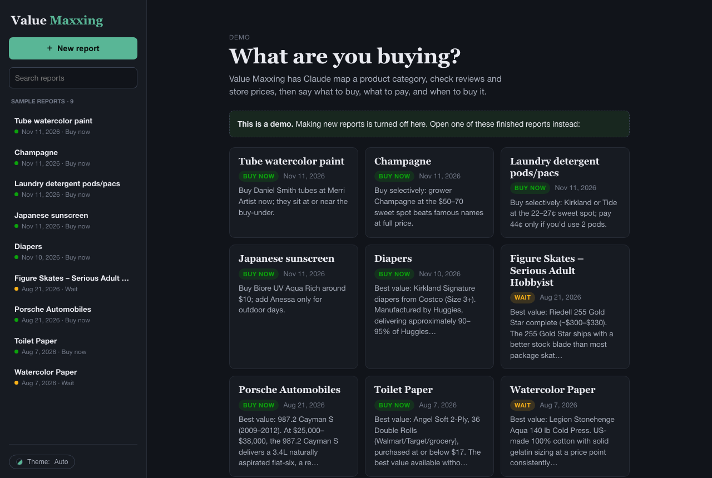
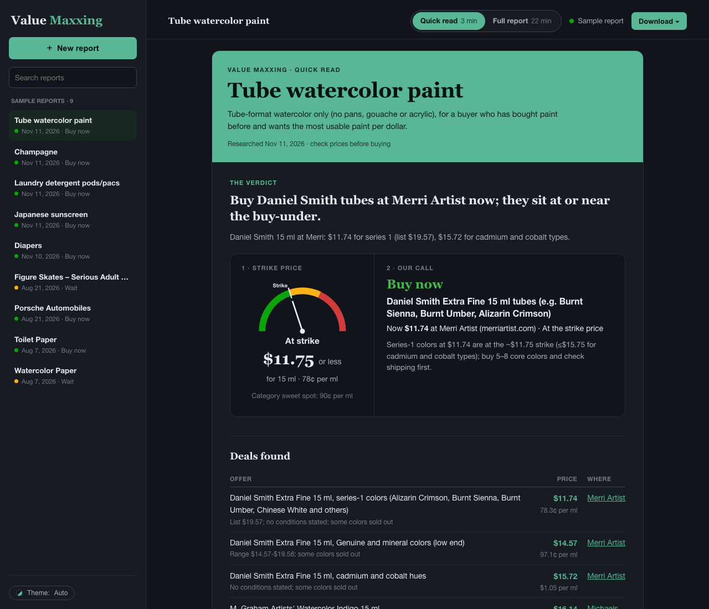

# Value Maxxing

Type a product category and get a **buying strategy**: what's worth buying, what to pay, and when to buy it, instead of a single "best product" pick.

**[Open the live demo →](https://jkw2lo.github.io/value-maxxing/)** It has nine sample reports, including laundry pods, Japanese sunscreen, champagne, watercolor paint, diapers and Porsches.



## What a report gives you

- **The call:** a strike price (buy at or under this) and a plain recommendation: *buy this exact item at this store now*, or *wait for this sale*. The dial shows how today's price compares with the strike price.
- **Deals found:** specific offers seen while researching, with store, price, price per unit and link.
- **Best of class vs. best value:** usually two different products, shown side by side.
- **Price per unit that makes sense for the category:** for example ¢ per pod, $ per ml of paint or $ per square foot of toilet paper, so different pack sizes compare fairly.
- **Where extra money stops paying off:** the price per unit above which you mostly pay for brand or rarity, with a chart.
- **Evidence:** a guide to reading the specs, marketing claims that don't matter, value traps, tiers, what experts and owners agree on, a product table with scores, sale timing, and ready-made shopping lists.
- **Two reading modes:** a 3-minute Quick read or the Full report. Export either as an HTML file, a Word document or a PDF.



## How it works

1. **Research.** Claude maps the category: brands, tiers, specs, and reviews from experts and owners. In **Live prices** mode it opens real store pages in the Claude desktop app's browser to read current prices. **Quick estimate** mode works from Claude's own knowledge.
2. **Structure.** The research is turned into JSON that matches a schema, in three parts that run in parallel. The parts are merged, checked and cleaned (gaps, filler text, mismatched units).
3. **Render.** One self-contained HTML file draws the report, with charts as inline SVG. There's no framework and no build step for the app itself.

The full app runs as a Claude Artifact. Report generation uses the viewer's own Claude account, and reports are saved there too. **The demo here is read-only:** generation is turned off, and it shows reports that were already made.

The thinking behind the reports is in [FRAMEWORK.md](FRAMEWORK.md).

## Use it with any AI tool (no API key)

The same viewer also works without Claude, through copy-paste prompts:

1. Open `viewer.html` in a browser.
2. Fill in the category, then copy the **research prompt** into an AI chat with web search turned on.
3. Copy the **structuring prompt** into the same chat. It replies with JSON.
4. Paste the reply into the viewer. It checks the data and draws the report.

If the reply gets cut off, switch to **three smaller prompts** and paste all three replies together. The prompts are also plain files in [`prompts/`](prompts/).

## What's in the repo

| Path | What it is |
|---|---|
| `viewer.html` | The whole app in one file: report generator, viewer, library and exports |
| `artifact.html` | The version published as a Claude Artifact (built from `viewer.html`) |
| `docs/index.html` | The read-only demo (built from `viewer.html` and `samples/`), served by GitHub Pages |
| `samples/` | Sample report data (JSON) used by the demo |
| `prompts/` | Copy-paste prompts for any AI tool |
| `schema/` | JSON Schema for a report, in full and split into three parts |
| `FRAMEWORK.md` | The method: the four calculations each report makes and how the report is layered |
| `build-artifact.mjs` / `build-demo.mjs` | Build scripts (Node, no dependencies) |

## Building

```bash
node build-demo.mjs      # viewer.html + samples/*.json → docs/index.html
node build-artifact.mjs  # viewer.html → artifact.html
```

To add a report to the demo, open it in the app, choose **Download → Report file**, and pull out its data. The file has a `<script id="vm-report-data">` tag holding `{ expertise, report }`. Save that as `samples/<name>.json`, then run `node build-demo.mjs`.

## Notes

- Prices in the sample reports were checked on each report's research date. They've likely changed since.
- The diapers, figure skates, Porsche, toilet paper and watercolor paper reports were rebuilt from older exports, which didn't save the one-line verdict. Their recommendation is worked out from the product data instead.
